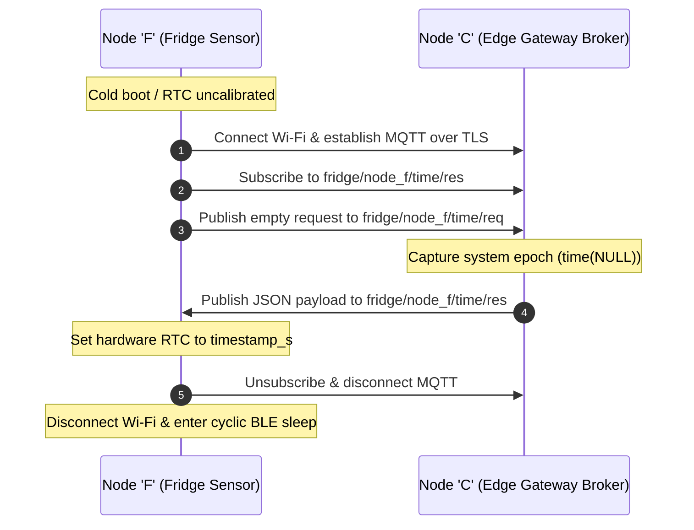

# CBF: Camera ('C') ↔ Fridge ('F') Interface Contract

This document defines the bidirectional communication interface between the edge gateway (**Node `'C'`**, Pi-top [4] Raspberry Pi 4) and the internal fridge sensor node (**Node `'F'`**, KidBright32 ESP32) for initial bootup time synchronization and RTC recalibration.

* **Endpoints:** Edge Gateway (**Node `'C'`**) ↔ Fridge Sensor Node (**Node `'F'`**)
* **Directionality:** Bidirectional (`B`)
* **Transport Protocol:** MQTT over TLS (`MQTTS`, Default Port: `8883`)
* **Security:** Transport-layer TLS 1.2/1.3 with server certificate validation (`MQTT_TLS_CA_CERT`)

> [!NOTE]
> **Ephemeral Connection Profile:**
> Node `'F'` is an ultra-low-power, battery-powered node that normally operates in deep sleep and broadcasts encrypted telemetry via BLE beacons ([`FUC.md`](file:///home/sirat/Code/SmarterFridge/interface/FUC.md)). Node `'F'` connects to the local MQTT broker *only* during initial cold boot or RTC invalidation to acquire a second-accurate 64-bit Unix timestamp, then terminates Wi-Fi/MQTT immediately to preserve battery life.

---

## 1. Secrets & Connection Reference

All cryptographic credentials and network configurations are strictly decoupled from source control:
* **C++ (Node `'F'`):** Provided via `#include "secrets.h"`
* **Python (Node `'C'`):** Provided via environment variables in `.env`
* **Shared Identifiers:**
  * `MQTT_BROKER_HOST` — Gateway hostname or local IP (e.g. `192.168.4.1`)
  * `MQTT_BROKER_PORT` — Secure MQTT port (`8883`)
  * `MQTT_USERNAME` — MQTT client username
  * `MQTT_PASSWORD` — MQTT client password
  * `MQTT_TLS_CA_CERT` — Root Certificate Authority PEM certificate to authenticate the Mosquitto broker

---

## 2. MQTT Topics & Message Flow

### A. Topic Architecture

| Topic | Publisher | Subscriber | QoS | Retain | Description |
|---|---|---|---|---|---|
| `fridge/node_f/time/req` | Node `'F'` (Fridge) | Node `'C'` (Gateway) | 1 | False | Request message triggering time synchronization on initial boot. |
| `fridge/node_f/time/res` | Node `'C'` (Gateway) | Node `'F'` (Fridge) | 1 | False | Response containing current second-accurate 64-bit Unix timestamp. |

### B. Bootup Synchronization Sequence



---

## 3. Data Schemas & Models

All payloads across this interface use UTF-8 JSON.

### A. Time Request (`fridge/node_f/time/req`)

Published by Node `'F'` upon connection to signal readiness for time recalibration.

```json
{
  "client_id": "node_f"
}
```

### B. Time Response (`fridge/node_f/time/res`)

Published by Node `'C'` providing current second-accurate 64-bit Unix timestamp.

```json
{
  "timestamp_s": 1729851600
}
```

| Field | Type | Unit | Description |
|---|---|---|---|
| `timestamp_s` | `uint64_t` / `int` | Seconds | Seconds elapsed since Unix Epoch (1970-01-01T00:00:00Z). |

### C. C++ Data Structures (Node `'F'`)

```c
#include <stdint.h>

// Parsed payload from fridge/node_f/time/res
struct TimeResponsePayload {
  uint64_t timestamp_s; // 64-bit Unix timestamp in seconds
};
```

### D. Python Data Models (Node `'C'`)

```python
from dataclasses import dataclass

@dataclass
class TimeResponsePayload:
    timestamp_s: int  # 64-bit Unix timestamp in seconds
```

---

## 4. Operational Invariants & Safety

1. **Second Precision Standard:** The timestamp represents seconds elapsed since Unix epoch (`time(NULL)`). Millisecond resolution is explicitly disallowed in accordance with system timestamp specifications.
2. **Timeout & Fallback:** If Node `'F'` does not receive a response on `fridge/node_f/time/res` within 5 seconds of publishing its request, it must retry up to 3 times before timing out, shutting down Wi-Fi, and falling back to its internal monotonic counter or last saved RTC value to prevent battery exhaustion.
3. **Pure Schema Standard:** This document defines data models, topics, and serialization formats only. Application serialization, network retries, and hardware RTC register updates are implemented locally within subproject firmware.
