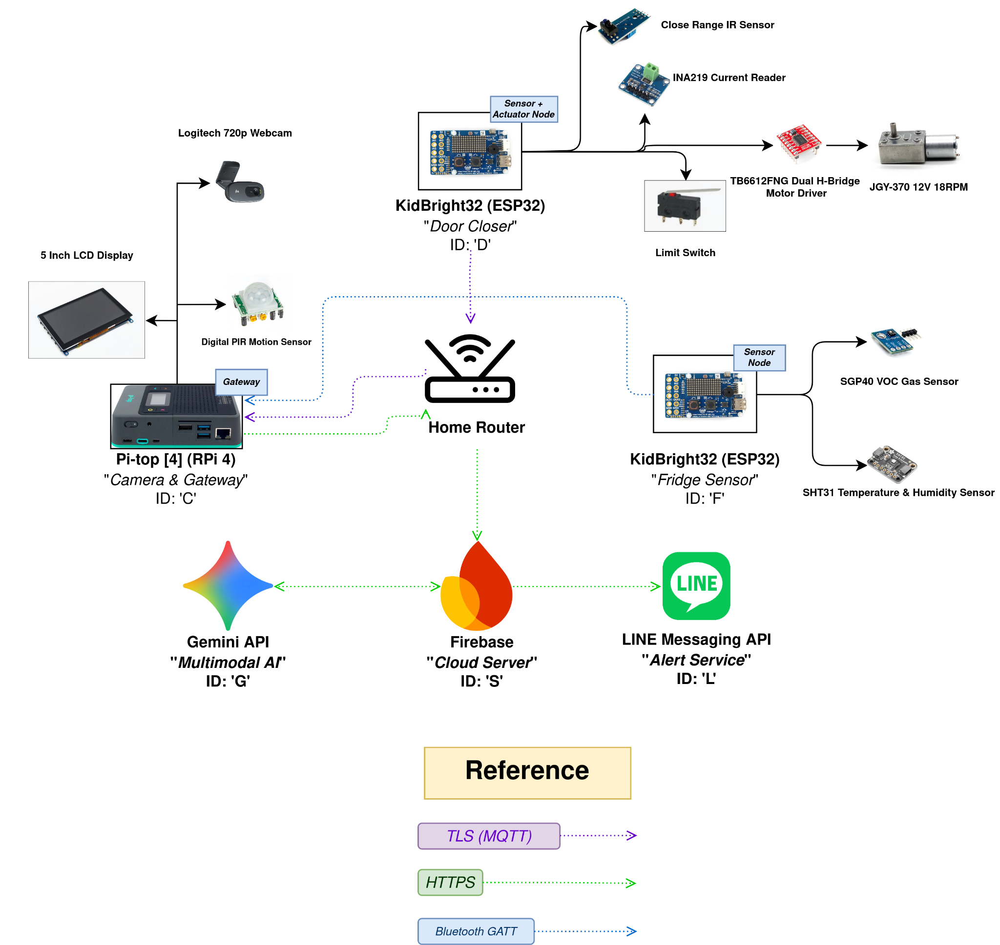

# FoodWarden Proposal

## Problem And Target User

- **Problem:** Food waste caused by perishables spoiling inside household refrigerators.
- **Target User:** Households and consumers with shared refrigerators.

The FoodWarden system addresses a widespread household issue: food waste. It specifically targets refrigerator waste, where perishables frequently spoil within days if left unmonitored.

FoodWarden tackles this problem by resolving three preventable points of failure:

1. **Food forgotten in the back of the fridge that expires and gets thrown away.**  
   We solve this with a food-logging station mounted on the front of the fridge. Users can quickly check items in and out, while keeping track of their active inventory in real time via an online dashboard.
2. **Unnoticed food spoilage that releases decay gases and bacteria, ruining surrounding fresh food.**  
   We solve this with a dedicated sensor node placed inside the compartment. The sensor continuously monitors air quality (VOCs) and temperature to catch spoiling food early and prevent cross-contamination.
3. **Perishables warming up when the refrigerator door is accidentally left open.**  
   We solve this with a motorized arm mounted on top of the fridge. Working alongside the front camera to detect human presence, the arm safely pushes the door shut if it is left ajar past a set time limit.

---

## Block Diagram

---

## Bill Of Materials

| Subsystem | Component | Qty | Unit Price | Subtotal |
|---|---|:---:|:---:|:---:|
| **C** | 5-inch HDMI TFT LCD (800×480) | 1 | Owned | - |
| **C** | Digital PIR Motion Sensor | 1 | Owned | - |
| **C** | Pi-top [4] | 1 | Owned | - |
| **C** | Logitech 720p Webcam | 1 | Owned | - |
| **D & F** | Kidbright 32 | 2 | Owned | - |
| **D** | TCRT5000 Digital IR Obstacle Sensor | 1 | Owned | - |
| **D** | INA 219 Current Reader | 1 | 119 | 119 |
| **D** | KW11-3Z Roller Lever Micro Limit Switch | 1 | 12 | 12 |
| **D** | Toshiba TB6612FNG Dual H-Bridge Driver | 1 | 59 | 59 |
| **D** | JGY-370 12V 18RPM Worm Gear Motor | 1 | 220 | 220 |
| **D** | VSTARCAM 12V 2A DC Wall Adapter + Female Jack | 1 | 75 | 75 |
| **D** | 3D Printed Mount & Sweeper Arm (ABS) | TBD | 10 Baht/gram | TBD |
| **D** | LM2596 DC-DC Buck Converter | 1 | 49 | 49 |
| **F** | SGP40 VOC Gas Sensor | 1 | 262 | 262 |
| **F** | SHT31 Temperature & Humidity Sensor | 1 | 90 | 90 |
| **F** | 18650 Battery Shield V3 | 1 | 167 | 167 |
| **F** | Vapcell INR18650 M35 3500mAh | 2 | 145 | 290 |
| **F** | Sealed Food Container + Silica Gel Desiccant | 1 | Owned | - |
| **S** | Firebase, Gemini API, LINE API | 1 | 0 (Free tier) | 0 |

**Total cost (excluding shipping, vouchers and 3D printed items):** 1,343 Baht

---

## Embedded Engineering Depth Items

We will choose **E1, E2, E3, E5, E7** as the engineering depth items that will be completed.

---

## Member Roles

| Student ID | Name | Roles |
|:---:|---|---|
| **6833046321** | Chawin Sinman | Embedded Developer (Gateway & Cloud) UI/UX & Dashboard Developer |
| **6833130321** | Nontapat Auetrongjit | Embedded Developer (Gateway & Cloud) |
| **6833150921** | Pranithi Tungmunkij | Embedded Developer (Gateway & Cloud) UI/UX & Dashboard Developer |
| **6833254521** | Sira Tongsima | Project Manager & Test Lead System Architect & Integration |
| **6833288921** | Alangkorn Thongkhong | Embedded Developer (Sensor Node) |
